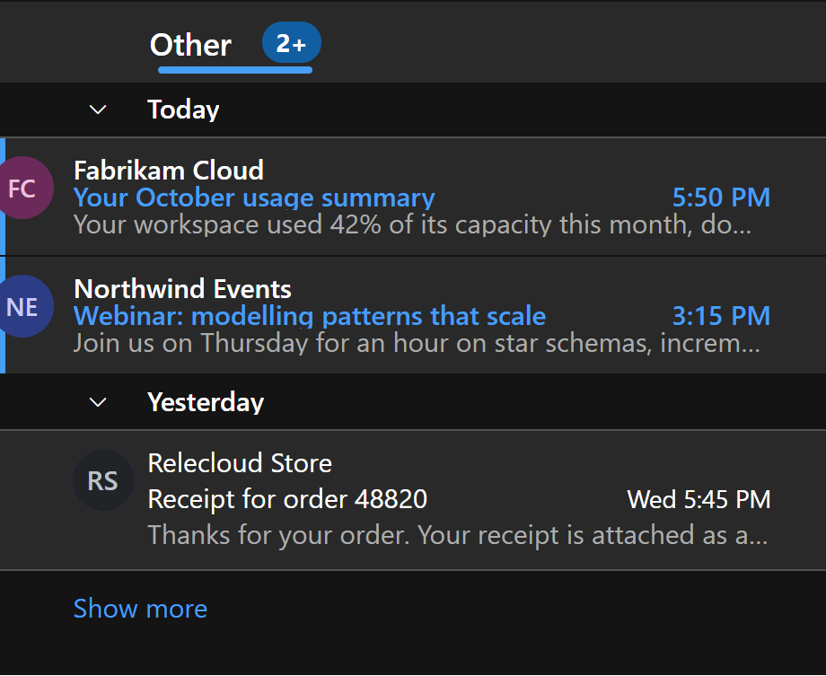

# Outlook Refined

A [Windhawk](https://windhawk.net) mod for the new Outlook for Windows (`olk.exe`). It gives the
folder pane groups that fold, puts an agenda and a month grid under your folders, tidies the
calendar and the reading pane, and makes printing a message print the message instead of the
whole window.

Everything happens inside Outlook's own page. The mod restyles Outlook's elements and adds a few
of its own; it never moves one of Outlook's, so Outlook keeps behaving as it did. Each tweak
stands alone: if an Outlook update breaks one, the rest keep working.

## What it changes

**Folder pane.** Favorites gather into groups that fold, with a count on a folded group.
Right-click a group header for its menu; Shift+right-click a favorite to rename it or move it
into a group. Pattern groups fill themselves: the Outgoing group collects every account's
Drafts, Sent and Outbox, and the Junk group every Junk Email folder. Each account can get a
compose button that starts a new message from that account, and a short label that replaces the
address Outlook appends to folder names. The pane can be dragged wider, the account trees fold
under one heading, and accounts reorder by dragging.

**Agenda.** Today and the next few days from every account's calendar sit at the bottom of the
folder pane, each event in its calendar's color, with Outlook's own event icons, a marker on
repeating events and a join button for online meetings. Above the feed, a month grid shades
each day by how many hours are booked; its arrows browse other months and a day opens its
events.

**Other inbox.** Optionally, the newest conversations from an inbox's Other tab sit below the
Focused list, drawn from Outlook's own list rows so they match it exactly. A button beside the
tabs switches back to Outlook's own arrangement.

**Calendar.** One row per account instead of one shared row, compact time zone columns, start
and end times on event tiles, and overlapping events cascaded rather than squeezed, with larger
pile-ups merged into a single tile that opens the group.

**Reading pane.** To and Cc share one line that expands when clicked, the blocked-content bar
shrinks to a chip, and the message body stops at a readable width. The ribbon loses the row of
group names under its buttons.

**Print.** Printing a message prints the message: the folder pane, message list, ribbon and
buttons go, panes that scroll are released so nothing is cut off at the visible edge, text is
black on white even when Outlook is in dark mode, quoted replies can be lightened or dropped,
pictures and tables are never split across two pages, and anything too wide for the page is
scaled to fit.

## Requirements

The last of these catches people out, so check it before you file a bug:

- The new Outlook for Windows (`olk.exe`), the one built on WebView2. Classic Outlook and the
  Microsoft Store "Mail" app are different programs, and this mod does not touch them.
- Windhawk 1.4 or newer.
- Restart Outlook after enabling the mod or changing a setting. Windows that are already open
  keep the script they started with.

## Install

From the Windhawk store: find "Outlook Refined", install, restart Outlook.

By hand: open Windhawk, choose Create new mod, replace the editor's contents with
[`mods/outlook-refined.wh.cpp`](mods/outlook-refined.wh.cpp), compile, exit editing mode, then
restart Outlook.

## Settings

| Setting | Default | What it does |
| --- | --- | --- |
| Favorites groups | on | Groups that fold, starting with Outgoing and Junk |
| Hidden favorites | empty | Favorite folder names to leave out |
| Compose buttons | empty | One button per account; a new message starts from that account |
| Account labels | empty | Short names that replace the address in folder names |
| Primary account address | empty | Leave empty to detect it |
| Accounts heading | Accounts | Heading that folds every account tree |
| Hide account trees | off | Favorites only |
| Hide "Add account" | off | |
| Resizable folder pane | on | Drag its right edge; double-click to reset |
| Folder pane width | 0 | 0 keeps Outlook's width |
| Agenda | on | The feed under the folder tree |
| Agenda days | 3 | Days it lists, today included |
| Month grid | on | Days shaded by hours booked |
| Other inbox under Focused | off | The Other card below the Focused list |
| Calendar, one row per account | on | |
| Calendar pane width | 180 | 0 keeps Outlook's width |
| Calendar, compact time zones | on | |
| Calendar, times on tiles | on | |
| Calendar, overlapping events | cascade and merge | Outlook's layout, cascade, or cascade and merge |
| Merge at | 3 | Overlapping events before they become one tile |
| Reading pane, To and Cc on one line | on | Click the line to expand it |
| Reading pane, compact blocked-content bar | on | |
| Reading pane, body width | 90ch | A CSS width, or empty for Outlook's own |
| Ribbon, hide group names | on | |
| Print, compact header | on | Drops the avatar and action buttons |
| Print, fit to the page width | only when too wide | Never, only when too wide, or always |
| Print, keep pictures and tables whole | on | |
| Print, quoted replies | lighten | Show, lighten, or hide the thread history |

## Editing inside Outlook

Groups, renames, folds, account order, pane width and the Other card's on/off state are edited
in Outlook itself, not in the settings, and are kept in Outlook's own storage on that PC. Drag a
favorite onto a group header to put it in that group, and Shift+right-click a favorite for its
menu.

## Privacy

The mod runs only inside Outlook's own page. It reads nothing from disk, opens no ports and
collects nothing.

The agenda, the month grid and the Other inbox card need your calendar and your inbox, and they
get them from Outlook's own mail service, the same one the window beside them is already using.
When Outlook calls that service, the mod keeps the authorization header Outlook sent, per
mailbox, in the page's memory, and reuses it to ask the same service for the next few days of
events or the newest Other conversations. Nothing is stored, written to disk, logged or sent
anywhere Outlook was not already talking to, no credentials are read or copied, and the headers
are not reachable from the page: the code that holds them exposes only a method that sends a
request. Turn the agenda, the month grid and the Other card off and no request is ever made.

## Known limits

None of these break anything, but each one looks like a bug if it arrives unannounced:

- An event that takes its color from a category gets its calendar's color instead. Outlook does
  not hand the category palette to its own page, so the mod cannot read it either.
- An account's events show up once Outlook has made its first call for that account in this
  session, usually within a few seconds of starting. Until then the agenda says which account it
  is still waiting for.
- Microsoft updates Outlook often. A tweak that leans on something they move will stop working
  on its own, and only that tweak: the mod changes nothing in Outlook itself.

## Uninstall

Disable the mod in Windhawk and restart Outlook. To clear the choices made inside Outlook as
well, open the developer tools on Outlook's page and remove the `olkt-` entries from local
storage.

## Credits

By [Analytic Endeavors](https://analyticendeavors.com). MIT licensed; see
[LICENSE](LICENSE). Issues and pull requests are welcome in this repository.
